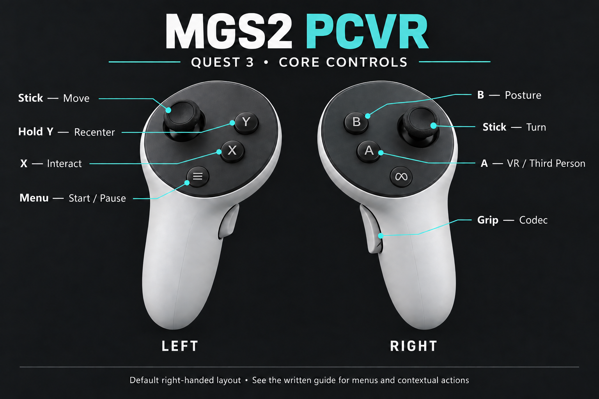

# MGS2 PCVR — v0.6.0

Play **METAL GEAR SOLID 2: Sons of Liberty — Master Collection Version** in PC VR, with headset tracking and motion-controller controls.

**Supports PS VR2 / SteamVR and Meta Quest 3 PC VR.** This unofficial mod uses **OpenXR** and renders both eyes from every game frame (**Two Eye rendering**, the default since v0.6.0). The older **AER (Alternate Eye Rendering)** is still available. It runs on a Windows gaming PC; it is not a standalone Quest app.

**[Download v0.6.0](https://github.com/Shiffo0/MGS2-PCVR/releases/tag/v0.6.0)** · [Installation](#installation) · [Controls](#controls) · [Known limitations](#known-limitations) · [Report a problem](https://github.com/Shiffo0/MGS2-PCVR/issues)

The **Tanker chapter with Snake** is the main focus. Switch between VR and Third Person as needed, and check your wrist for radar and LIFE information. **Plant / Raiden support is still in development**: many weapons and items now work in VR, but a complete VR playthrough is not supported yet.

## New in v0.6.0

**Two Eye rendering is now the default.** Both eyes get a fresh image from every game frame: up to **60 images per second per eye**, where AER gives each eye about 30. Surfaces that briefly vanished in one eye with some MGSHDFix setups in v0.5.0 are fixed. AER remains available: **Home → VR Rendering → AER**, or `vr_second_eye=0` in `dg_hook.on`.

**MGSHDFix is required for Two Eye rendering, and also to get 4K resolution in the headset.** Install [MGSHDFix](https://github.com/ShizCalev/MGSHDFix#installation) separately. For 4K, set the resolution to **3840 × 2160** in the MGSHDFix Config Tool (in the game's `plugins` folder), and set Internal Resolution and Internal Upscaling to Default in the game's launcher. Without MGSHDFix, use AER.

**Also new:**
- **Rifles:** hold the AKS-74u, M4 and PSG-1 with both hands, and reload with your hands (a blue magazine hint shows where it goes). Raise the PSG-1 scope to your eye to look through it, and walk with the rifle at the hip.
- **Pistols:** two-handed grip for the M9, USP and SOCOM; insert the magazine from below when reloading; work the M9 slide by hand.
- **Scope and Camera:** raise Raiden's Scope or Snake's Camera to your eye to look through it; zoom with the grips.
- **HF blade:** hits land during the swing itself; Raiden's body follows when you turn with the stick.
- **Menus:** point at menu entries with a laser and select with the trigger (OPTIONS, main menu, LOAD). **VR SETTINGS** now sits in the game's OPTIONS menu, below EXIT.

See the [release notes](RELEASE_NOTES.md).

## Requirements

- Your own Steam copy of **MGS2 — Master Collection Version** on Windows.
- A Windows gaming PC capable of running the game and PC VR.
- **PS VR2 with Sense controllers and a supported PC connection**, or **Meta Quest 3 with Touch Plus controllers**, connected to PC VR.
- An active OpenXR runtime for your PC VR setup.
- **[MGSHDFix](https://github.com/ShizCalev/MGSHDFix)** for **Two Eye rendering** (the default) and **4K headset rendering**; install separately.

Other headsets and game versions have not been validated.

## Installation

1. Launch the unmodified game once, then close it.
2. Install [MGSHDFix](https://github.com/ShizCalev/MGSHDFix#installation) (needed for the default Two Eye rendering).
3. Connect your headset and start your PC VR software. For **PS VR2**, use **SteamVR** and select it under **SteamVR Settings → OpenXR**. For **Quest Link / Air Link**, select Meta as active under **Meta Quest Link → Settings → General → OpenXR Runtime**. Close the game before switching runtimes.
4. Download **`MGS2-PCVR-v0.6.0.zip`** from the [release page](https://github.com/Shiffo0/MGS2-PCVR/releases/tag/v0.6.0). Choose the mod ZIP under **Assets**, not GitHub's automatic **Source code** downloads.
5. In Steam, right-click the game → **Manage → Browse local files**. Extract the ZIP into the folder containing **`METAL GEAR SOLID2.exe`**, keeping its folder structure.
6. Back up any existing files before replacing them. MGSHDFix and this mod both use the Ultimate ASI Loader (`winmm.dll`), so one copy serves both. If other mods provide `openxr_loader.dll`, start with a clean mod setup.
7. Launch the game through Steam with your headset connected. The control table below uses **Quest button names**; for PS VR2, check the corresponding actions in SteamVR controller bindings.
8. Start with **Tanker**, and check the controls and limitations below.

### Updating or uninstalling

Close the game before changing files. Back up your mod files and settings before updating, and use the supplied `dg_hook.on` to get the new defaults. Keep `dg_hand_calibration.bin` and `dg_favorites.dat`. To disable the mod, move `dg_hook.asi` out of the game folder. To uninstall it, remove the files supplied in the ZIP and restore your backups. Keep shared loaders if another mod uses them. The mod package does not replace your saves.

## Controls

Controls below use **Quest button names** and the **default right-handed layout**. PS VR2 button assignments can differ through SteamVR; check its controller bindings for the corresponding actions. To open the Codec, bring your right hand near your right ear before pressing the grip.

| Input | Action |
| --- | --- |
| Left stick | Move; up/down on ladders when engaged |
| Right stick | Turn; camera zoom when using the photo camera |
| Right **A** | Switch VR / Third Person during gameplay |
| Right **B** | Posture / crouch action |
| Left **X** | Interact: doors, handles and contextual actions; hold where the interaction requires it |
| Hold left **Y** | Recenter your view |
| Left **Menu** | Start / pause |
| Right trigger | Weapon action; pistols follow their aim / fire / release behavior |
| Left trigger | Melee / contextual choke action |
| Left grip | Contextual grab / hold |
| Right grip, with the right hand near the right ear | Codec; move the hand into position before pressing the grip |
| Right trigger + **B** | Unarmed: save both wrist alignments; armed: calibrate weapon aim |
| Right stick click | Weapon selection radial |
| Left stick click | Item selection radial |
| Left hand on the front of a rifle, or under a pistol grip | Two-handed grip; move the hands apart to let go |
| Left hand to the magazine well of an empty weapon | Reload; a blue magazine hint marks the spot on rifles, pistol magazines go in from below |
| Left hand on the M9 slide, pull back | Work the slide |
| Raise the PSG-1 scope to your eye | Look through the scope; hold right / left grip to zoom in / out |
| Raise the Scope or Camera to your eye (Raiden / Snake) | Look through it; right grip zooms in, left grip zooms out; with the Camera, the right trigger takes a photo |
| Hold right grip with the Nikita or Stinger | Weapon sight; release to return |
| Left grip, with the left hand near the left ear | Thermal goggles on/off (experimental, when owned) |
| Swing the right hand with the HF blade (VR) | Slash (across / up / down) or stab (thrust forward); no button needed |
| Left hand on the HF blade + hold left grip | Block |
| Point at a menu entry, then right trigger | Select it (OPTIONS, main menu, LOAD) |

**Radial favourites** are saved in `dg_favorites.dat` beside the game executable and survive restarts.

**Radial selection:** start with the stick centered and triggers released. Hold the relevant stick click, move that stick toward the entry, and press the **same controller's trigger** to confirm. Releasing the stick click while an entry is highlighted also selects it. The opposite trigger cancels. Release the controls and return the stick to center before opening another selection. Release the selection trigger before using the weapon.

**Menus:** point with the laser and press the right trigger, or use the right stick to navigate, **A or right trigger** to confirm, and **B** to go back. **VR SETTINGS** is in the game's OPTIONS menu, below EXIT. Gameplay actions depend on context and are not all available in menus or scripted scenes.

**Mod settings (keyboard):** with the game focused during gameplay, press **Home** to open or close the settings panel. Use **Up/Down** to select View (stereo/mono), VR Pistol Reload, M9 Slide, Desktop Observer or VR Rendering; use **Enter** or **Left/Right** to toggle an available option. VR Rendering starts at **TWO EYE**; choose **AER** if MGSHDFix is not installed. Desktop Observer starts at **Right Eye**; **Both Eyes (EXP)** is experimental. Changes here last for the session. After closing, release the buttons and center both sticks to resume control.

**Photo camera:** begin at minimum zoom and let it settle briefly before zooming. Security-camera traversal remains a separate limitation.

## Persistent hand alignment

Automatic defaults position the hands from controller tracking. While **unarmed**, hold both hands in a comfortable neutral pose with both controllers tracked, then press **right trigger + B** to save a one-time wrist-alignment override for both hands. A later deliberate calibration replaces it.

The override persists across game restarts in `dg_hand_calibration.bin` beside the game executable. Weapon changes, animations, first/third-person switches, new levels, cutscenes and tracking loss preserve the calibration/default. Native animations can temporarily take control of the hands, and reach limits still apply.

Keep this file when updating. To restore defaults, close the game, rename `dg_hand_calibration.bin`, then restart.

## Known limitations

- **Two Eye rendering:** requires MGSHDFix. An occasional flickering surface can still appear; switch to AER if it bothers you. The Both Eyes desktop observer is experimental.
- **New weapon and item features** (two-handed grips, hand reloading, PSG-1 at the hip, Scope and Camera to the eye) are new in this version. Hand positions can still be a few centimetres off, and your own arm can sometimes block part of the view through the Scope or Camera.
- **First-person locker entry:** the problem reported in v0.3.4 has not been verified as fixed; use Third Person if affected.
- **Camera tanker:** the photo camera does not yet take its picture from the correct position in first person.
- **Security-camera sections:** use **Third Person** to get past cameras, then switch back to VR with **A**.
- **Hanging and moving while hanging:** still experimental; use **Third Person** for these actions.
- **Plant / Raiden:** incomplete. A full VR campaign is not supported yet (Still need to verify swimming / Emma's sections).

## AER, Two Eye rendering and performance

**Two Eye rendering (default)** gives both eyes a fresh image from every game frame: up to **60 images per second per eye**. The game draws one eye as usual, and the mod redraws that same frame from the other eye's position. This avoids the cost of running the game twice. It requires MGSHDFix.

**AER (Alternate Eye Rendering)** renders the left and right eye on alternating game frames. At 60 game frames per second, each eye receives roughly **30 fresh images per second**, and you may notice ghosting or judder during motion. Use it when MGSHDFix is not installed or when Two Eye rendering shows problems on your setup.

Keep the game's frame rate stable and use settings your PC can sustain. Comfort varies between players.

## What's next?

Future work focuses on **Raiden and the Plant chapter**: throwing grenades with the controllers, further weapon and item polish, and further HF-blade work. There is no release date for complete Raiden support yet.

## Troubleshooting and feedback

- **No VR image:** check your PC VR connection, active OpenXR runtime and installation folder. The mod files must sit beside the game executable. Make sure the `.on` files have not gained an extra `.txt` extension.
- **View offset or facing the wrong way:** face forward and hold **Y** to recenter.
- **Stuck at a camera or hanging section:** press **A** to switch to Third Person.
- **Two Eye rendering looks wrong (colours differ between the eyes, low resolution, surfaces missing in one eye):** check that MGSHDFix is installed (`plugins\MGSHDFix.asi`), or switch to AER with **Home → VR Rendering**.
- **VR stops after about an hour:** close the game and check that `dg_hook.on` contains `seconds=0`.
- **Problems with other mods:** keep MGSHDFix installed for Two Eye / 4K; disable other optional mods while diagnosing compatibility.

[Report a problem](https://github.com/Shiffo0/MGS2-PCVR/issues) with your mod version, game version, headset, PC VR software, GPU, chapter/location and steps to reproduce it. Mention whether it happens in VR, Third Person or both. Review logs before sharing them and avoid uploading personal data or game files.

## Credits and license

Created by **Shiffo0**. This is an unofficial fan project, not affiliated with or endorsed by Konami, Sony or Meta. The game is sold separately.

The mod's original code and documentation are available under the **[MIT License](LICENSE)**. This license covers the contributors' own work, not the game, its assets or trademarks. Third-party components retain their own licenses; notices are included in the download.

- [MGSHDFix](https://github.com/ShizCalev/MGSHDFix); see [third-party notices](THIRD_PARTY_NOTICES.md).
- [Ultimate ASI Loader](https://github.com/ThirteenAG/Ultimate-ASI-Loader) by ThirteenAG.
- [OpenXR SDK / loader](https://github.com/KhronosGroup/OpenXR-SDK) by Khronos and contributors.

For contributors: [mod source and build instructions](https://github.com/Shiffo0/MGS2-PCVR/tree/main/src).

The controller illustration is AI-generated. Use the written control table for contextual actions.
